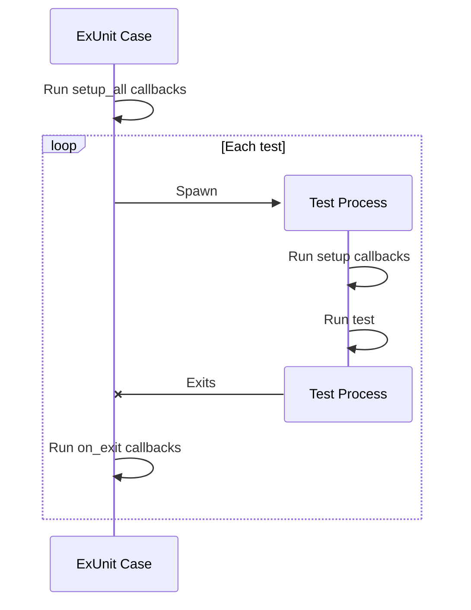

<!-- source: https://hexdocs.pm/ex_unit/ExUnit.md -->
# `ExUnit`
[🔗](https://github.com/elixir-lang/elixir/blob/v1.20.4/lib/ex_unit/lib/ex_unit.ex#L5)

Unit testing framework for Elixir.

## Example

A basic setup for ExUnit is shown below:

    # File: assertion_test.exs

    # 1) Start ExUnit.
    ExUnit.start()

    # 2) Create a new test module and use "ExUnit.Case".
    defmodule AssertionTest do
      # 3) Note that we pass "async: true", this runs the tests in the
      #    test module concurrently with other test modules. The
      #    individual tests within each test module are still run serially.
      use ExUnit.Case, async: true

      # 4) Use the "test" macro instead of "def" for clarity.
      test "the truth" do
        assert true
      end
    end

To run the tests above, run the file using `elixir` from the
command line. Assuming you named the file `assertion_test.exs`,
you can run it as:

    $ elixir assertion_test.exs

## Case, Callbacks and Assertions

See `ExUnit.Case` and `ExUnit.Callbacks` for more information
about defining test cases and setting up callbacks.

The `ExUnit.Assertions` module contains a set of macros to
generate assertions with appropriate error messages.

## Integration with Mix

Mix is the project management and build tool for Elixir. Invoking `mix test`
from the command line will run the tests in each file matching the pattern
`*_test.exs` found in the `test` directory of your project.

You must create a `test_helper.exs` file inside the
`test` directory and put the code common to all tests there.

The minimum example of a `test_helper.exs` file would be:

    # test/test_helper.exs
    ExUnit.start()

Mix will load the `test_helper.exs` file before executing the tests.
It is not necessary to `require` the `test_helper.exs` file in your test
files. Run `mix help test` for more information.

# `configure_opts`

```elixir
@type configure_opts() :: [
  {:assert_receive_timeout, non_neg_integer()}
  | {:autorun, boolean()}
  | {:capture_log, boolean() | [{:level, Logger.level()}]}
  | {:colors,
     enabled: boolean(),
     success: atom(),
     invalid: atom(),
     skipped: atom(),
     failure: atom(),
     error_info: atom(),
     extra_info: atom(),
     location_info: [atom()],
     diff_insert: atom(),
     diff_insert_whitespace: IO.ANSI.ansidata(),
     diff_delete: atom(),
     diff_delete_whitespace: IO.ANSI.ansidata()}
  | {:exclude, atom() | [atom() | {atom(), any()}]}
  | {:exit_status, non_neg_integer()}
  | {:failures_manifest_path, String.t()}
  | {:formatters, [module()]}
  | {:include, atom() | [atom() | {atom(), any()}]}
  | {:max_cases, pos_integer()}
  | {:max_failures, pos_integer() | :infinity}
  | {:only_test_ids, [test_id()]}
  | {:rand_algorithm, atom()}
  | {:refute_receive_timeout, non_neg_integer()}
  | {:seed, non_neg_integer()}
  | {:slowest, non_neg_integer()}
  | {:slowest_modules, non_neg_integer()}
  | {:stacktrace_depth, non_neg_integer()}
  | {:timeout, pos_integer()}
  | {:trace, boolean()}
  | {:test_location_relative_path, String.t()}
  | {atom(), term()}
]
```

Configuration options for ExUnit.

See `configure/1` for detailed documentation of each option.

# `failed`

```elixir
@type failed() :: [{Exception.kind(), reason :: term(), Exception.stacktrace()}]
```

The error state returned by `ExUnit.Test` and `ExUnit.TestModule`

# `state`

```elixir
@type state() ::
  nil
  | {:excluded, binary()}
  | {:failed, failed()}
  | {:invalid, ExUnit.TestModule.t()}
  | {:skipped, binary()}
```

All tests start with a state of `nil`.

A finished test can be in one of five states:

  1. Passed (also represented by `nil`)
  2. Failed
  3. Skipped (via @tag :skip)
  4. Excluded (via :exclude filters)
  5. Invalid (when setup_all fails)

# `suite_result`

```elixir
@type suite_result() :: %{
  excluded: non_neg_integer(),
  failures: non_neg_integer(),
  skipped: non_neg_integer(),
  total: non_neg_integer()
}
```

A map representing the results of running a test suite

# `test_id`

```elixir
@type test_id() :: {module(), name :: atom()}
```

# `after_suite`
*since 1.8.0* 

```elixir
@spec after_suite((suite_result() -&gt; any())) :: :ok
```

Sets a callback to be executed after the completion of a test suite.

Callbacks set with `after_suite/1` must accept a single argument, which is a
map containing the results of the test suite's execution.

If `after_suite/1` is called multiple times, the callbacks will be called in
reverse order. In other words, the last callback set will be the first to be
called.

# `async_run`
*since 1.12.0* 

```elixir
@spec async_run() :: Task.t()
```

Starts tests asynchronously while test cases are still loading.

It returns a task that must be given to `await_run/0` when a result
is desired.

# `await_run`
*since 1.12.0* 

```elixir
@spec await_run(Task.t()) :: suite_result()
```

Awaits for a test suite that has been started with `async_run/0`.

# `configuration`

```elixir
@spec configuration() :: Keyword.t()
```

Returns ExUnit configuration.

For the available configuration options, see `configure/1`.

# `configure`

```elixir
@spec configure(configure_opts()) :: :ok
```

Configures ExUnit.

## Options

ExUnit supports the following options:

  * `:assert_receive_timeout` - the timeout to be used on `assert_receive`
    calls in milliseconds, defaults to `100`;

  * `:autorun` - if ExUnit should run by default on exit. Defaults to `true`;

  * `:capture_log` - if ExUnit should default to keeping track of log messages
    and print them on test failure. Can be overridden for individual tests via
    `@tag capture_log: false`. This can also be configured to a specific level
    with `capture_log: [level: LEVEL]`, to capture all logs but only keep those
    above `LEVEL`. Note that `on_exit` and `setup_all` callbacks may still log,
    as they run outside of the testing process. To silent those, you can use
    `ExUnit.CaptureLog.capture_log/2` or consider disabling logging altogether.

  * `:colors` - a keyword list of color options to be used by some formatters:
    * `:enabled` - boolean option to enable colors, defaults to `IO.ANSI.enabled?/0`;

    * `:success` - success message (defaults to `:green`)
    * `:invalid` - invalid test message (defaults to `:yellow`)
    * `:skipped` - skipped test message (defaults to `:yellow`)
    * `:failure` - failed test message (defaults to `:red`)
    * `:error_info` - display of actual error (defaults to `:red`)
    * `:extra_info` - additional information (defaults to `:cyan`)
    * `:location_info` - filename and tags (defaults to `[:bright, :black]`)
    * `:diff_insert` - color of the insertions on diffs, defaults to `:green`;
    * `:diff_insert_whitespace` - color of the whitespace insertions on diffs,
      defaults to `IO.ANSI.color_background(2, 0, 0)`;
    * `:diff_delete` - color of the deletions on diffs, defaults to `:red`;
    * `:diff_delete_whitespace` - color of the whitespace deletions on diffs,
      defaults to `IO.ANSI.color_background(0, 2, 0)`;

  * `:exclude` - specifies which tests are run by skipping tests that match the
    filter. For more information, see the "Tags" and "Filters" sections in the
    documentation for `ExUnit.Case`;

  * `:exit_status` - specifies an alternate exit status to use when the test
    suite fails. Defaults to `2`;

  * `:failures_manifest_path` - specifies a path to the file used to store failures
    between runs;

  * `:formatters` - the formatters that will print results,
    defaults to `[ExUnit.CLIFormatter]`;

  * `:include` - specifies which tests are run by skipping tests that do not
    match the filter. Keep in mind that all tests are included by default, so unless they are
    excluded first, the `:include` option has no effect. To only run the tests
    that match the `:include` filter, exclude the `:test` tag first.
    For more information, see the "Tags" and "Filters" sections in the
    documentation for `ExUnit.Case`;

  * `:max_cases` - maximum number of tests to run in parallel. Only tests from
    different modules run in parallel. It defaults to `System.schedulers_online * 2`
    to optimize both CPU-bound and IO-bound tests;

  * `:max_failures` - the suite stops evaluating tests when this number of test failures
    is reached. All tests within a module that fail when using the
    [`setup_all/1,2`](`ExUnit.Callbacks.setup_all/1`) callbacks
    are counted as failures. Defaults to `:infinity`;

  * `:only_test_ids` - a list of `{module_name, test_name}` tuples that limits
    what tests get run. This is typically used by Mix to filter which tests
    should run;

  * `:rand_algorithm` - algorithm to be used when generating the test seed.
    Available algorithms can be found in Erlang's
    [`:rand`](`:rand`) documentation (see
    [`:rand.builting_arg/0`](https://www.erlang.org/doc/apps/stdlib/rand.html#t:builtin_alg/0)).
    Available since v1.16.0. Before v1.16.0, the algorithm was hard-coded to
    `:exs1024`. On Elixir v1.16.0 and after, the default changed to `:exsss`;

  * `:refute_receive_timeout` - the timeout to be used on `refute_receive`
    calls in milliseconds, defaults to `100`;

  * `:seed` - an integer seed value to randomize the test suite. This seed
    is also mixed with the test module and name to create a new unique seed
    on every test, which is automatically fed into the [`:rand`](`:rand`) module.
    This provides randomness between tests, but predictable and reproducible
    results. A `:seed` of `0` will disable randomization and the tests in each
    file will always run in the order that they were defined in;

  * `:slowest` - prints timing information for the N slowest tests. Running
    ExUnit with slow test reporting automatically runs in `trace` mode. It
    is disabled by default;

  * `:slowest_modules` - prints timing information for the N slowest test modules. Running
    ExUnit with slow test reporting automatically runs in `trace` mode. It
    is disabled by default;

  * `:stacktrace_depth` - configures the stacktrace depth to be used
    on formatting and reporters, defaults to `20`;

  * `:timeout` - sets the timeout for the tests in milliseconds, defaults to `60_000`;

  * `:trace` - sets ExUnit into trace mode, this sets `:max_cases` to `1` and
    prints each test case and test while running. Note that in trace mode test
    timeouts will be ignored as timeout is set to `:infinity`;

  * `:test_location_relative_path` - the test location is the file:line information
    printed by tests as a shortcut to run a given test. When this value is set,
    the value is used as a prefix for the test itself. This is typically used by
    Mix to properly set-up umbrella projects;

Any arbitrary configuration can also be passed to `configure/1` or `start/1`,
and these options can then be used in places such as custom formatters. These
other options will be ignored by ExUnit itself.

# `fetch_test_supervisor`
*since 1.11.0* 

```elixir
@spec fetch_test_supervisor() :: {:ok, pid()} | :error
```

Fetches the test supervisor for the current test.

Returns `{:ok, supervisor_pid}` or `:error` if not called from the test process.

This is the same supervisor as used by `ExUnit.Callbacks.start_supervised/2`
and similar, see `ExUnit.Callbacks` module documentation for more information.

# `plural_rule`

```elixir
@spec plural_rule(binary()) :: binary()
```

Returns the pluralization for `word`.

If one is not registered, returns the word appended with an "s".

# `plural_rule`

```elixir
@spec plural_rule(binary(), binary()) :: :ok
```

Registers a `pluralization` for `word`.

If one is already registered, it is replaced.

# `run`

```elixir
@spec run([module()]) :: suite_result()
```

Runs the tests. It is invoked automatically
if ExUnit is started via `start/1`.

From Elixir v1.14, it accepts an optional list of modules to run
as part of the suite. This is often used to rerun modules already
loaded in memory.

Returns a map containing the total number of tests, the number
of failures, the number of excluded tests and the number of skipped tests.

# `start`

```elixir
@spec start(configure_opts()) :: :ok
```

Starts ExUnit and automatically runs tests right before the
VM terminates.

It accepts a set of `options` to configure `ExUnit`
(the same ones accepted by `configure/1`).

If you want to run tests manually, you can set the `:autorun` option
to `false` and use `run/0` to run tests.

---

*Consult [api-reference.md](api-reference.md) for complete listing*

<!-- source: https://hexdocs.pm/ex_unit/ExUnit.Case.md -->
# `ExUnit.Case`
[🔗](https://github.com/elixir-lang/elixir/blob/v1.20.4/lib/ex_unit/lib/ex_unit/case.ex#L5)

Helpers for defining test cases.

This module must be used in other modules as a way to configure
and prepare them for testing.

When used, it accepts the following options:

  * `:async` - configures tests in this module to run concurrently with
    tests in other modules. Tests in the same module never run concurrently
    (with the exception of tests run via the `:parameterize` option - see below).
    It should be enabled only if tests do not change any global state.
    Defaults to `false`.

  * `:group` (since v1.18.0) - configures the **group** this module belongs to.
    Tests in the same group never run concurrently. Tests from different
    groups (or with no groups) can run concurrently when `async: true`
    is given. By default, this module belongs to no group (defaults to `nil`).

  * `:register` - when `false`, does not register this module within
    ExUnit server. This means the module won't run when ExUnit suite runs.

  * `:parameterize` (since v1.18.0) - a list of maps to parameterize tests.
    If both `:async` and `:parameterize` are given, the different parameters
    run concurrently. See the "Parameterized tests" section below for more
    information.

> #### `use ExUnit.Case` {: .info}
>
> When you `use ExUnit.Case`, it will import the functionality
> from `ExUnit.Assertions`, `ExUnit.Callbacks`, `ExUnit.DocTest`,
> and this module itself.

## Examples

    defmodule AssertionTest do
      # Use the module
      use ExUnit.Case, async: true

      # The "test" macro is imported by ExUnit.Case
      test "always pass" do
        assert true
      end
    end

## Context

All tests receive a context as an argument. The context is particularly
useful for sharing information between callbacks and tests:

    defmodule KVTest do
      use ExUnit.Case

      setup do
        {:ok, pid} = KV.start_link()
        {:ok, pid: pid}
      end

      test "stores key-value pairs", context do
        assert KV.put(context[:pid], :hello, :world) == :ok
        assert KV.get(context[:pid], :hello) == :world
      end
    end

As the context is a map, it can be pattern matched on to extract
information:

    test "stores key-value pairs", %{pid: pid} = _context do
      assert KV.put(pid, :hello, :world) == :ok
      assert KV.get(pid, :hello) == :world
    end

## Tags

The context is used to pass information from the callbacks to
the test. In order to pass information from the test to the
callback, ExUnit provides tags.

By tagging a test, the tag value can be accessed in the context,
allowing the developer to customize the test. Let's see an
example:

    defmodule FileTest do
      # Changing directory cannot be async
      use ExUnit.Case, async: false

      setup context do
        # Read the :cd tag value
        if cd = context[:cd] do
          prev_cd = File.cwd!()
          File.cd!(cd)
          on_exit(fn -> File.cd!(prev_cd) end)
        end

        :ok
      end

      @tag cd: "fixtures"
      test "reads UTF-8 fixtures" do
        File.read("README.md")
      end
    end

In the example above, we have defined a tag called `:cd` that is
read in the setup callback to configure the working directory the
test is going to run on.

Tags are also very effective when used with case templates
(`ExUnit.CaseTemplate`) allowing callbacks in the case template
to customize the test behaviour.

Note a tag can be set in two different ways:

    @tag key: value
    @tag :key       # equivalent to setting @tag key: true

If a tag is given more than once, the last value wins.

### Module and describe tags

A tag can be set for all tests in a module or describe block by
setting `@moduletag` or `@describetag` inside each context
respectively:

    defmodule ApiTest do
      use ExUnit.Case
      @moduletag :external

      describe "makes calls to the right endpoint" do
        @describetag :endpoint

        # ...
      end
    end

If you are setting a `@moduletag` or `@describetag` attribute, you must
set them after your call to `use ExUnit.Case` otherwise you will see
compilation errors.

If the same key is set via `@tag`, the `@tag` value has higher
precedence.

The `setup_all` blocks only receive tags that are set using `@moduletag`.

### Known tags

The following tags are set automatically by ExUnit and are
therefore reserved:

  * `:async` - if the test case is in async mode

  * `:file` - the file on which the test was defined

  * `:line` - the line on which the test was defined

  * `:module` - the module on which the test was defined

  * `:registered` - used for `ExUnit.Case.register_attribute/3` values

  * `:test` - the test name

  * `:test_group` - the group the test belongs to

  * `:test_pid` - the PID of the testing process

  * `:test_type` - the test type used when printing test results. It can also
    be used for filtering. It is set by ExUnit to `:test`, `:doctest`, or
    the equivalent type given to `register_test/6`

  * `:describe` - the describe block the test belongs to (if in a describe)

  * `:describe_line` - the line the describe block begins on (if in a describe).
    It can be used to run all tests in the describe block given by line

  * `:doctest` - the module or the file being doctested (if a doctest)

  * `:doctest_data` - additional metadata about doctests stored in a map,
    such as the `:end_line`, available for reflection purposes (if a doctest)

  * `:doctest_line` - the line the doctest was defined (if a doctest).
    It can be used to run a doctest defined at the given source line

The following tags customize how tests behave:

  * `:capture_log` - see the "Log Capture" section below

  * `:skip` - skips the test with the given reason

  * `:timeout` - customizes the test timeout in milliseconds (defaults to `60_000`).
    Accepts `:infinity` as a timeout value.

  * `:tmp_dir` - (since v1.11.0) see the "Tmp Dir" section below

## Filters

Tags can also be used to identify specific tests, which can then
be included or excluded using filters. The most common functionality
is to exclude some particular tests from running, which can be done
via `ExUnit.configure/1`:

    # Exclude all external tests from running
    ExUnit.configure(exclude: [external: true])

From now on, ExUnit will not run any test that has the `:external` option
set to `true`. This behaviour can be reversed with the `:include` option
which is usually passed through the command line:

    $ mix test --include external:true

Run `mix help test` for more information on how to run filters via Mix.

Another use case for tags and filters is to exclude all tests that have
a particular tag by default, regardless of its value, and include only
a certain subset:

    ExUnit.configure(exclude: :os, include: [os: :unix])

A given include/exclude filter can be given more than once:

    ExUnit.configure(exclude: [os: :unix, os: :windows])

Keep in mind that all tests are included by default, so unless they are
excluded first, the `include` option has no effect.

## Parameterized tests

Sometimes you want to run the same tests but with different parameters.
In ExUnit, it is possible to do so by passing a `:parameterize` key to
`ExUnit.Case`. The value must be a list of maps which will be the
parameters merged into the test context.

For example, Elixir has a module called `Registry`, which can have type
`:unique` or `:duplicate`, and can control its concurrency factor using
the `:partitions` option. If you have a number of tests that *behave the
same* across all of those values, you can parameterize those tests with:

    use ExUnit.Case,
      async: true,
      parameterize:
        for(kind <- [:unique, :duplicate],
            partitions <- [1, 8],
            do: %{kind: kind, partitions: partitions})

Then, in your tests, you can access the parameters as part of the context:

    test "starts a registry", %{kind: kind, partitions: partitions} do
      ...
    end

Use parameterized tests with care:

  * Although parameterized tests run concurrently when `async: true` is also given,
    abuse of parameterized tests may make your test suite slower

  * If you use parameterized tests and then find yourself adding conditionals
    in your tests to deal with different parameters, then parameterized tests
    may be the wrong solution to your problem. Consider creating separated
    tests and sharing logic between them using regular functions

## Log Capture

ExUnit can optionally suppress printing of log messages that are generated
during a test. Log messages generated while running a test are captured and
only if the test fails are they printed to aid with debugging.

You can opt into this behaviour for individual tests by tagging them with
`:capture_log` or enable log capture for all tests in the ExUnit configuration:

    ExUnit.start(capture_log: true)

This default can be overridden by `@tag capture_log: false` or
`@moduletag capture_log: false`.

Since `setup_all` blocks don't belong to a specific test, log messages generated
in them (or between tests) are never captured. If you want to suppress these
messages as well, remove the console backend globally by setting:

    config :logger, :default_handler, false

## Tmp Dir

ExUnit automatically creates a temporary directory for tests tagged with
`:tmp_dir` and puts the path to that directory into the test context.
The directory is removed before being created to ensure we start with a blank
slate.

The temporary directory path is unique (includes the test module and test name)
and thus appropriate for running tests concurrently. You can customize the path
further by setting the tag to a string, e.g.: `tmp_dir: "my_path"`, which would
make the final path to be: `tmp/<module>/<test>/my_path`.

Example:

    defmodule MyTest do
      use ExUnit.Case, async: true

      @tag :tmp_dir
      test "with tmp_dir", %{tmp_dir: tmp_dir} do
        assert tmp_dir =~ "with tmp_dir"
        assert File.dir?(tmp_dir)
      end
    end

As with other tags, `:tmp_dir` can also be set as `@moduletag` and
`@describetag`.

## Process Architecture

An ExUnit test case uses several processes when it runs. These are illustrated below.



  1. First, all `ExUnit.Callbacks.setup_all/1` callbacks run in a single process, sequentially,
     in the order they were defined.

  2. Then, a new process is spawned for the test itself. In this process, first all
     `ExUnit.Callbacks.setup/1` callbacks run, in the order they were defined. Then,
     the test itself is executed.

  3. After the test exits, a new process is spawned to run all `ExUnit.Callbacks.on_exit/2`,
     in the reverse order they were defined.

# `env`

```elixir
@type env() :: module() | Macro.Env.t()
```

# `register_attribute_opts`

```elixir
@type register_attribute_opts() :: [accumulate: boolean(), persist: boolean()]
```

# `describe`
*since 1.3.0* *macro* 

Describes tests together.

Every describe block receives a name which is used as prefix for
upcoming tests. Inside a block, `ExUnit.Callbacks.setup/1` may be
invoked and it will define a setup callback to run only for the
current block. The describe name is also added as a tag, allowing
developers to run tests for specific blocks.

## Examples

    defmodule StringTest do
      use ExUnit.Case, async: true

      describe "String.downcase/1" do
        test "with ascii characters" do
          assert String.downcase("HELLO") == "hello"
        end

        test "with Unicode" do
          assert String.downcase("HÉLLÒ") == "héllò"
        end
      end
    end

When using Mix, you can run all tests in a describe block by name:

    $ mix test --only describe:"String.downcase/1"

or by passing the exact line the describe block starts on:

    $ mix test path/to/file:123

Note describe blocks cannot be nested. Instead of relying on hierarchy
for composition, developers should build on top of named setups. For
example:

    defmodule UserManagementTest do
      use ExUnit.Case, async: true

      describe "when user is logged in and is an admin" do
        setup [:log_user_in, :set_type_to_admin]

        test ...
      end

      describe "when user is logged in and is a manager" do
        setup [:log_user_in, :set_type_to_manager]

        test ...
      end

      defp log_user_in(context) do
        # ...
      end
    end

By forbidding hierarchies in favor of named setups, it is straightforward
for the developer to glance at each describe block and know exactly the
setup steps involved.

# `get_last_registered_test`
*since 1.15.0* 

```elixir
@spec get_last_registered_test(env()) :: ExUnit.Test.t() | nil
```

Returns the most recently registered test case as an `%ExUnit.Test{}`
struct.

This is used by third-party utilities to allow compile-time configuration
using test tags without having to explicitly pass the test context at
run-time. It is intended to be invoked in macros before the test module
is compiled.

Raises if called with a module that has already been compiled.

# `register_attribute`
*since 1.3.0* 

```elixir
@spec register_attribute(env(), atom(), register_attribute_opts()) :: :ok
```

Registers a new attribute to be used during `ExUnit.Case` tests.

The attribute values will be available through `context.registered`.
Registered values are cleared after each `test/3` similar
to `@tag`.

This function takes the same options as `Module.register_attribute/3`.

## Examples

    defmodule MyTest do
      use ExUnit.Case

      ExUnit.Case.register_attribute(__MODULE__, :fixtures, accumulate: true)

      @fixtures :user
      @fixtures {:post, insert: false}
      test "using custom attribute", context do
        assert context.registered.fixtures == [{:post, insert: false}, :user]
      end

      test "custom attributes are cleared per test", context do
        assert context.registered.fixtures == []
      end
    end

# `register_describe_attribute`
*since 1.10.0* 

```elixir
@spec register_describe_attribute(env(), atom(), register_attribute_opts()) :: :ok
```

Registers a new describe attribute to be used during `ExUnit.Case` tests.

The attribute values will be available through `context.registered`.
Registered values are cleared after each `describe/2` similar
to `@describetag`.

This function takes the same options as `Module.register_attribute/3`.

## Examples

    defmodule MyTest do
      use ExUnit.Case

      ExUnit.Case.register_describe_attribute(__MODULE__, :describe_fixtures, accumulate: true)

      describe "using custom attribute" do
        @describe_fixtures :user
        @describe_fixtures {:post, insert: false}

        test "has attribute", context do
          assert context.registered.describe_fixtures == [{:post, insert: false}, :user]
        end
      end

      describe "custom attributes are cleared per describe" do
        test "doesn't have attributes", context do
          assert context.registered.describe_fixtures == []
        end
      end
    end

# `register_module_attribute`
*since 1.10.0* 

```elixir
@spec register_module_attribute(env(), atom(), register_attribute_opts()) :: :ok
```

Registers a new module attribute to be used during `ExUnit.Case` tests.

The attribute values will be available through `context.registered`.

This function takes the same options as `Module.register_attribute/3`.

## Examples

    defmodule MyTest do
      use ExUnit.Case

      ExUnit.Case.register_module_attribute(__MODULE__, :module_fixtures, accumulate: true)

      @module_fixtures :user
      @module_fixtures {:post, insert: false}

      test "using custom attribute", context do
        assert context.registered.module_fixtures == [{:post, insert: false}, :user]
      end

      test "still using custom attribute", context do
        assert context.registered.module_fixtures == [{:post, insert: false}, :user]
      end
    end

# `register_test`

> This function is deprecated. Use register_test/6 instead.

# `register_test`
*since 1.11.0* 

Registers a function to run as a test for this module.

This is used by third-party projects to implement macros like
`property/3` that works like `test` but instead defines a property.
See `test/3` implementation for an example of invoking this function.

The test type will be converted to a string and pluralized for
display. You can use `ExUnit.plural_rule/2` to set a custom
pluralization.

# `test`
*macro* 

Defines a not implemented test with a string.

Provides a convenient macro that allows a test to be defined
with a string, but not yet implemented. The resulting test will
always fail and print a "Not implemented" error message. The
resulting test case is also tagged with `:not_implemented`.

## Examples

    test "this will be a test in future"

# `test`
*macro* 

Defines a test with `message`.

The test may also define a pattern, which will be matched
against the test context. For more information on contexts, see
`ExUnit.Callbacks`.

## Examples

    test "true is equal to true" do
      assert true == true
    end

---

*Consult [api-reference.md](api-reference.md) for complete listing*

<!-- source: https://hexdocs.pm/ex_unit/ExUnit.Callbacks.md -->
# `ExUnit.Callbacks`
[🔗](https://github.com/elixir-lang/elixir/blob/v1.20.4/lib/ex_unit/lib/ex_unit/callbacks.ex#L5)

Defines ExUnit callbacks.

This module defines the `setup/1`, `setup/2`, `setup_all/1`, and
`setup_all/2` macros, as well as process lifecycle and management
functions, such as `on_exit/2`, `start_supervised/2`, `stop_supervised/1`
and `start_link_supervised!/2`.

The setup callbacks may be used to define [test fixtures](https://en.wikipedia.org/wiki/Test_fixture#Software)
and run any initialization code which help bring the system into a known
state. They are defined via macros and each one can optionally receive a map
with test state and metadata, usually referred to as the `context`.
Optionally, the context to be used in the tests can be extended by the
setup callbacks by returning a properly structured value (see below).

The `setup_all` callbacks are invoked only once per module, before any
test is run. All `setup` callbacks are run before each test. No callback
is run if the test case has no tests or all tests have been filtered out.

`setup` and `setup_all` callbacks can be defined by either a block, an atom
naming a local function, a `{module, function}` tuple, or a list of atoms/tuples.

Both can opt to receive the current context by specifying it
as a parameter if defined by a block. Functions used to define a test
setup must accept the context as a single argument.

A test module can define multiple `setup` and `setup_all` callbacks,
and they are invoked in order of appearance.

`start_supervised/2` is used to start processes under a supervisor. The
supervisor is linked to the current test process. The supervisor as well
as all child processes are guaranteed to terminate before any `on_exit/2`
callback runs.

`on_exit/2` callbacks are registered on demand, usually to undo an action
performed by a setup callback. `on_exit/2` may also take a reference,
allowing the callback to be overridden in the future. A registered `on_exit/2`
callback will always run, while failures in `setup` and `setup_all` will stop
all remaining setup callbacks from executing.

Finally, `setup_all` callbacks run in a separate process per module, while
all `setup` callbacks run in the same process as the test itself. `on_exit/2`
callbacks always run in a separate process, as implied by their name. The
test process always exits with reason `:shutdown`, which means any process
linked to the test process will also exit, although asynchronously. Therefore
it is preferred to use `start_supervised/2` to guarantee all supervised processes
have fully terminated before the next test starts.

Here is a rundown of the life cycle of the test process:

  1. the test process is spawned
  2. it runs `setup/2` callbacks
  3. it runs the test itself
  4. the test process exits with reason `:shutdown`
  5. it stops all supervised processes synchronously
  6. `on_exit/2` callbacks are executed in a separate process

## Context

`setup_all` or `setup` may return one of:

  * the atom `:ok`
  * a keyword list or map
  * a tuple in the shape of `{:ok, keyword() | map()}`

If a keyword list or map is returned, it will be merged into the current context
and will be available in all subsequent `setup_all`, `setup`, and the `test`
itself.

Returning anything else from `setup_all` will force all tests to fail,
while a bad response from `setup` causes the current test to fail.

## Examples

    defmodule AssertionTest do
      use ExUnit.Case, async: true

      # "setup_all" is called once per module before any test runs
      setup_all do
        IO.puts("Starting AssertionTest")

        # Context is not updated here
        :ok
      end

      # "setup" is called before each test
      setup do
        IO.puts("This is a setup callback for #{inspect(self())}")

        on_exit(fn ->
          IO.puts("This is invoked once the test is done. Process: #{inspect(self())}")
        end)

        # Returns extra metadata to be merged into context.
        # Any of the following would also work:
        #
        #     {:ok, %{hello: "world"}}
        #     {:ok, [hello: "world"]}
        #     %{hello: "world"}
        #
        [hello: "world"]
      end

      # Same as above, but receives the context as argument
      setup context do
        IO.puts("Setting up: #{context.test}")

        # We can simply return :ok when we don't want to add any extra metadata
        :ok
      end

      # Setups can also invoke a local or imported function that returns a context
      setup :invoke_local_or_imported_function

      test "always pass" do
        assert true
      end

      test "uses metadata from setup", context do
        assert context[:hello] == "world"
        assert context[:from_named_setup] == true
      end

      defp invoke_local_or_imported_function(context) do
        [from_named_setup: true]
      end
    end

It is also common to define your setup as a series of functions,
which are put together by calling `setup` or `setup_all` with a
list of function names. Each of these functions receive the context and can
return any of the values allowed in `setup` blocks:

    defmodule ExampleContextTest do
      use ExUnit.Case

      setup [:step1, :step2, :step3, {OtherModule, :step4}]

      defp step1(_context), do: [step_one: true]
      defp step2(_context), do: {:ok, step_two: true} # return values with shape of {:ok, keyword() | map()} allowed
      defp step3(_context), do: :ok # Context not modified

      test "context was modified", context do
        assert context[:step_one] == true
        assert context[:step_two] == true
      end
    end

Finally, as discussed in the `ExUnit.Case` documentation, remember
that the initial context metadata can also be set via `@tag`s, which
can then be accessed in the `setup` block:

    defmodule ExampleTagModificationTest do
      use ExUnit.Case

      setup %{login_as: username} do
        {:ok, current_user: username}
      end

      @tag login_as: "max"
      test "tags modify context", context do
        assert context[:login_as] == "max"
        assert context[:current_user] == "max"
      end
    end

# `child_spec_overrides`

```elixir
@type child_spec_overrides() :: Supervisor.child_spec_overrides()
```

# `on_exit`

```elixir
@spec on_exit(term(), (-&gt; term())) :: :ok
```

Registers a callback that runs once the test exits.

`callback` is a function that receives no arguments and
runs in a separate process than the caller. Its return
value is irrelevant and is discarded.

`on_exit/2` is usually called from `setup/1` and `setup_all/1`
callbacks, often to undo the action performed during the setup.

However, `on_exit/2` may also be called dynamically. An "ID" (the
`name_or_ref` argument) can be used to guarantee that the callback
will be invoked only once. ExUnit uses this term to identify an
`on_exit/2` handler: if you want to override a previous handler, for
example, use the same `name_or_ref` across multiple `on_exit/2`
calls.

If `on_exit/2` is called inside `setup/1` or inside a test, it's
executed in a blocking fashion after the test exits and *before
running the next test*. This means that no other test from the same
test case will be running while the `on_exit/2` callback for a
previous test is running. `on_exit/2` is executed in a different
process than the test process. On the other hand, if `on_exit/2` is
called inside a `setup_all/1` callback then `callback` is executed
after running *all tests* (see `setup_all/1` for more information).

## Examples

    setup do
      File.write!("fixture.json", "{}")
      on_exit(fn -> File.rm!("fixture.json") end)
    end

You can use the same `name_or_ref` across multiple `on_exit/2` calls
to "override" the registered handler:

    setup do
      on_exit(:drop_table, fn ->
        Database.drop_table()
      end)
    end

    test "a test that shouldn't drop the table" do
      on_exit(:drop_table, fn -> :ok end)
    end

Relying too much on overriding callbacks like this can lead to test
cases that are hard to understand and with too many layers of
indirection. However, it can be useful in some cases or for library
authors, for example.

# `setup`
*macro* 

Defines a callback to be run before each test in a case.

Accepts one of these:

  * a block
  * an atom naming a local function
  * a `{module, function}` tuple
  * a list of atoms and `{module, function}` tuples

Can return values to be merged into the context, to set up the state for
tests. For more details, see the "Context" section shown above.

`setup/1` callbacks are executed in the same process as the test process.

## Examples

    defp clean_up_tmp_directory(context) do
      # perform setup
      :ok
    end

    setup :clean_up_tmp_directory

    setup [:clean_up_tmp_directory, :another_setup]

    setup do
      [conn: Plug.Conn.build_conn()]
    end

    setup {MyModule, :my_setup_function}

# `setup`
*macro* 

Defines a callback to be run before each test in a case.

This is similar to `setup/1`, but the first argument is the context.
The `block` argument can only be a block.

For more details, see the "Context" section shown above.

## Examples

    setup context do
      [conn: Plug.Conn.build_conn()]
    end

# `setup_all`
*macro* 

Defines a callback to be run before all tests in a case.

Accepts one of these:

  * a block
  * an atom naming a local function
  * a `{module, function}` tuple
  * a list of atoms and `{module, function}` tuples

Can return values to be merged into the `context`, to set up the state for
tests. For more details, see the "Context" section shown above.

`setup_all/1` callbacks are executed in a separate process than tests.
All `setup_all/1` callbacks are executed in order in the same process.

## On-Exit Handlers

On-exit handlers that you register inside `setup_all/1` callbacks
are executed at once after all tests in the module have been run.
They are all executed *in the same process*, which is a separate
process dedicated to running these handlers. These handlers are
executed in the reverse order of their respective `setup_all/1`
callbacks.

## Examples

    # One-arity function name
    setup_all :clean_up_tmp_directory

    # A module and function
    setup_all {MyModule, :my_setup_function}

    # A list of one-arity functions and module/function tuples
    setup_all [:clean_up_tmp_directory, {MyModule, :my_setup_function}]

    defp clean_up_tmp_directory(_context) do
      # perform setup
      :ok
    end

    # A block
    setup_all do
      [conn: Plug.Conn.build_conn()]
    end

The context returned by `setup_all/1` will be available in all subsequent
`setup_all`, `setup`, and the `test` itself. For instance, the `conn` from
the previous example can be accessed as:

    test "fetches current users", %{conn: conn} do
      # ...
    end

### Handlers

You can define "global" on-exit handlers in `setup_all/1` callbacks:

    setup_all do
      Database.create_table_for(__MODULE__)

      on_exit(fn ->
        Database.drop_table_for(__MODULE__)
      end)

      :ok
    end

The handler in the example above will be executed only once, after
running all tests in the module.

# `setup_all`
*macro* 

Defines a callback to be run before all tests in a case.

Similar as `setup_all/1` but also takes a context. The second argument
must be a block. See the "Context" section in the module documentation.

## Examples

    setup_all _context do
      [conn: Plug.Conn.build_conn()]
    end

# `start_link_supervised!`
*since 1.14.0* 

```elixir
@spec start_link_supervised!(
  Supervisor.child_spec() | module() | {module(), term()},
  child_spec_overrides()
) :: pid()
```

Same as `start_supervised!/2` but links the started process to the test process.

If the process that was started crashes, the crash is propagated to the test process,
failing the test and printing the cause of the crash.

Note that if the started process terminates before it is linked to the test process,
this function will exit with reason `:noproc`.

> #### To link or not to link {: .warning}
>
> When using `start_link_supervised!/2`, the test process will be linked to the
> spawned processes. When the test process exits, it exits with reason `:shutdown`,
> and the crash signal propagates to all linked processes virtually simultaneously,
> which can lead to processes terminating in an unpredictable order if they are not
> trapping exits. This is particularly problematic when you have processes that the
> test starts with `start_link_supervised!/2` and that depend on each other.
>
> If you need guaranteed shutdown order, use `start_supervised!/2`. This way the
> test process exiting does not affect the started processes, and they will be shut down
> *by the test supervisor* in reverse order, ensuring graceful termination.

# `start_supervised`
*since 1.5.0* 

```elixir
@spec start_supervised(
  Supervisor.child_spec() | module() | {module(), term()},
  child_spec_overrides()
) ::
  Supervisor.on_start_child()
```

Starts a child process under the test supervisor.

It expects a child specification or a module, similar to the ones
given to `Supervisor.start_link/2`. For example, if your application
starts a supervision tree by running:

    Supervisor.start_link([MyServer, {OtherSupervisor, ...}], ...)

You can start those processes under test in isolation by running:

    start_supervised(MyServer)
    start_supervised({OtherSupervisor, :initial_value})

A keyword list can also be given if there is a need to change
the child specification for the given child process:

    start_supervised({MyServer, :initial_value}, restart: :temporary)

See the `Supervisor` module for a discussion on child specifications
and the available specification keys.

The started process is not linked to the test process and a crash will
not necessarily fail the test. To start and link a process to guarantee
that any crash would also fail the test use `start_link_supervised!/2`.

This function returns `{:ok, pid}` in case of success, otherwise it
returns `{:error, reason}`.

The advantage of starting a process under the test supervisor is that
it is guaranteed to exit before the next test starts. Therefore, you
don't need to remove the process at the end of your tests via
`stop_supervised/1`. You only need to use `stop_supervised/1 ` if you
want to remove a process from the supervision tree in the middle of a
test, as simply shutting down the process would cause it to be restarted
according to its `:restart` value.

Finally, since Elixir v1.17.0, the test supervisor has both `$ancestors`
and `$callers` key in its process dictionary pointing to the test process.
This means developers can invoke `Process.get(:"$callers", [])` in their
`start_link` function and forward it to the spawned process, which may set
`Process.put(:"$callers", callers)` during its initialization. This may be
useful in projects who track process ownership during tests. You can learn
more about these keys in [the `Task` module](`Task#module-ancestor-and-caller-tracking`).

# `start_supervised!`
*since 1.6.0* 

```elixir
@spec start_supervised!(
  Supervisor.child_spec() | module() | {module(), term()},
  child_spec_overrides()
) ::
  pid()
```

Same as `start_supervised/2` but returns the PID on success and raises if
not started properly.

# `stop_supervised`
*since 1.5.0* 

```elixir
@spec stop_supervised(id :: term()) :: :ok | {:error, :not_found}
```

Stops a child process started via `start_supervised/2`.

This function expects the `id` in the child specification.
For example:

    {:ok, _} = start_supervised(MyServer)
    :ok = stop_supervised(MyServer)

It returns `:ok` if there is a supervised process with such
`id`, `{:error, :not_found}` otherwise.

# `stop_supervised!`
*since 1.10.0* 

```elixir
@spec stop_supervised!(id :: term()) :: :ok
```

Same as `stop_supervised/1` but raises if it cannot be stopped.

---

*Consult [api-reference.md](api-reference.md) for complete listing*
